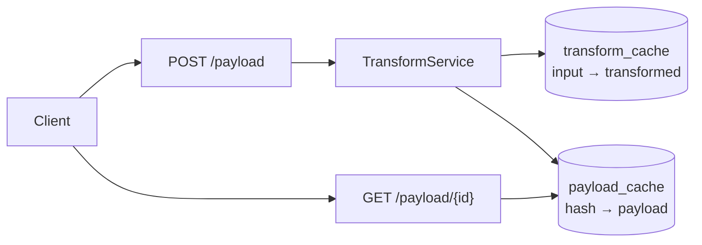

# micro-cache

FastAPI caching microservice: clients `POST` two string lists, the service transforms
each string (simulated external call), interleaves the results, and caches everything
in PostgreSQL. Repeat inputs reuse cached strings and return the same payload id —
the transformer never runs twice for the same input.



## How the cache works

Two levels, both in Postgres:

1. **String cache** (`transform_cache`, unique `input_str`) — a hit skips the
   transformer call entirely.
2. **Payload cache** (`payload_cache`, unique `interleaving_hash`) — the same
   input pair returns the existing id instead of creating a new row.

## Prerequisites

- Python ≥ 3.14, [uv](https://docs.astral.sh/uv/)
- Docker + Compose (for the containerized run)
- Local Postgres on `:5432` with `db_cache` / `test_db_cache` (for local run/tests)

## Quickstart

```bash
# Docker (Postgres + API + migrations, API on :7777)
docker compose up --build

# Local API (needs local Postgres + src/.env, see Configuration)
uv sync
uv run uvicorn src.main:app --reload   # :8000
```

## API

| Method | Endpoint        | Body / Response |
|--------|-----------------|-----------------|
| POST   | `/payload`      | `{"input_lst1": [...], "input_lst2": [...]}` (equal length) → `{"created_id": N}` |
| GET    | `/payload/{id}` | → `{"output": "A1, B1, A2, B2, ..."}` · unknown id → `404` · unequal lists → `400` |

```bash
curl -X POST :7777/payload -H 'Content-Type: application/json' \
  -d '{"input_lst1":["first string"],"input_lst2":["other string"]}'
# {"created_id":1}
curl :7777/payload/1
# {"output":"fir$t $tring, 0ther $tring"}
```

## CLI (`cache-cli`)

Test client for the service: each iteration does `POST` then `GET`.
Pydantic Settings parses and sanitizes all arguments.

```bash
uv run cache-cli --json '{"list_1":["a"],"list_2":["b"]}'          # inline JSON → stdout
uv run cache-cli -i payload.json -o out.json                       # file → file
echo '{...}' | uv run cache-cli -i - -r 3                          # stdin, 3 iterations
uv run cache-cli -H http://127.0.0.1:7777 -j '{...}'               # compose host
```

| Flag | Meaning | Default |
|------|---------|---------|
| `-H, --host` | Server base URL | `http://127.0.0.1:8000` |
| `-r, --repeat` | POST+GET iterations | `1` |
| `-i, --input` | Input file, `-` = stdin (exactly one of `--input`/`--json`) | — |
| `-j, --json` | Inline JSON payload | — |
| `-o, --output` | Output file, `-` = stdout | `-` |

Notes: `-H` (capital) is host — `-h` stays help. Accepts both `list_1/list_2`
(task spec) and `input_lst1/input_lst2` (server schema). Exit codes:
`0` ok · `1` input/request error · `2` argument error.

## Configuration

All settings come from environment (`.env` file for local, `docker/.env-docker`
for compose): `MODE` (`DEV`/`TEST`), `DB_*` and `TEST_DB_*` (`USER/PASS/HOST/PORT/NAME`).
Tests assert `MODE=TEST` and run against the separate test database, which is
dropped/recreated per session — dev data is never touched.

## Tests · Lint · Types

```bash
uv run pytest              # needs test DB (see above); asyncio_mode=auto via pytest-asyncio
uv run ruff check src/
uv run pyright
```

## Migrations

Alembic (sync `psycopg` driver — the app itself uses async `asyncpg`):

```bash
uv run alembic -c src/alembic.ini upgrade head
```

## Layout

```
src/
  api/routers/        HTTP layer (status codes only, no business logic)
  api/services/       caching policy (transform only on cache miss)
  api/dependencies/   FastAPI DI (overridable in tests)
  repositories/       data access, no commits (commit policy: db/uow.py)
  models/             SQLAlchemy entities (unique indexes = cache keys)
  schemas/            request/response DTOs
  db/                 engine/session (pooled in DEV, NullPool in TEST)
  migrations/         Alembic versions
  cli.py              cache-cli (entry point)
  config.py           env-driven settings
tests/integrations/   service-level tests against the test DB
docker/               Dockerfile, app.sh, .env-docker
```
